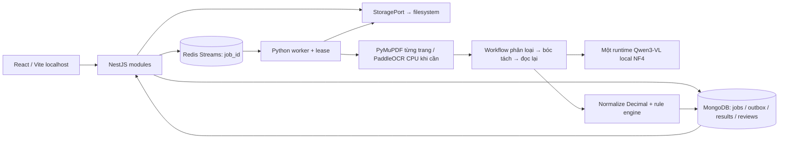

# Kiến trúc MVP

Backend chia modules dossiers, documents, jobs, findings, reviews; core cung cấp kết nối và storage port. Python `domain` chứa normalization, models và rules, không import Transformers/Redis/Mongo. `application` điều phối qua runtime/documents ports, `infrastructure` triển khai adapters, `entrypoints` giữ vòng nhận message và thiết lập runtime.

## Độ bền của job

- Mongo tạo job `queued` với danh sách document IDs bất biến và request_key unique theo dossier.
- Dispatcher quét queued mỗi 3 giây, enqueue job_id rồi mới cập nhật dispatch_at. Redis lỗi không mất job; quá 30 giây queued có thể được enqueue lại.
- Worker nhận bằng consumer group, dùng XAUTOCLAIM để nhận pending entry quá 100 giây. Mongo claim có lease 90 giây; heartbeat mỗi 20 giây. Consumer khác không được ghi khi token đã thay đổi.
- Tối đa ba lần claim. Lease bị bỏ dở lần thứ ba chuyển failed. Inference OOM có retry riêng một lần với input/output nhỏ hơn.
- Ghi nguyên tử terminal status và result trong cùng Mongo job document. Sau đó project result vào collection có unique job_id, rồi ACK. Crash giữa hai bước được sửa khi nhận lại message hoặc vòng reconcile.
- Lỗi xử lý được lưu retry/failed trước ACK. queued retry được dispatcher phát lại. Finding ID được băm từ job/rule/version/cặp tài liệu, review gắn finding cụ thể.

Đây là giao nhận có thể lặp với hiệu ứng lưu kết quả idempotent, không khẳng định message chỉ giao một lần. Không dùng distributed transaction hoặc Mongo replica set. Vòng projection hiện quét tối đa 100 terminal jobs mỗi lượt, còn repair qua message làm đường phục hồi bổ sung; phù hợp MVP local, cần pagination/maintenance khi dữ liệu tăng.

## Bằng chứng và phạm vi

Model chỉ trả raw values và trích dẫn. Adapter gắn trích dẫn duy nhất vào block PDF/OCR có thật; bbox ở cấp block, không hứa độ chính xác từng ký tự. Trích dẫn không gắn được, giá trị thiếu hoặc số/ngày mơ hồ đều không được dùng để kết luận match/mismatch. Crop đọc lại chỉ xuất phát từ block đã tồn tại; khi không có vùng xác định thì đọc lại trang với giới hạn token/pixel.

Mỗi field giữ raw, normalized, unit/currency, document/page, evidence_text, bbox nullable, coordinate system, kích thước trang, phương pháp, trạng thái và scope. Có null cho trường thiếu. PDF sử dụng points, OCR sử dụng pixels của ảnh xử lý. Highlight quy đổi tỷ lệ trên ảnh preview cùng tỷ lệ trang.

Rule gross weight/packages chỉ so sánh một tổng shipment rõ ràng mỗi chứng từ cùng đơn vị, không cộng các dòng/container. Container/seal so sánh tập giá trị shipment; chưa ánh xạ cặp container–seal theo container. Invoice total chỉ chạy khi có các dòng với ID khác nhau, currency đồng nhất và thuế/phí/chiết khấu rõ ràng. Các giới hạn này cố ý dẫn đến insufficient_data khi chưa đủ căn cứ.

## Giới hạn vận hành

Không antivirus, không OCR/model benchmark thực tế, không HA, không phân quyền. Timeout Python dùng signal trên Linux; mã native có thể chỉ trả quyền điều khiển sau khi tác vụ native kết thúc, nên chưa chứng minh hard-kill timeout với GPU bị treo. Không tự xóa streams/files; cần chính sách lưu giữ trước khi dùng lâu dài. Chưa có chỉnh sửa raw extraction qua UI, chỉ review finding. Frontend polling giữ toàn bộ kết quả một hồ sơ trong bộ nhớ; cần phân trang khi mở rộng.
